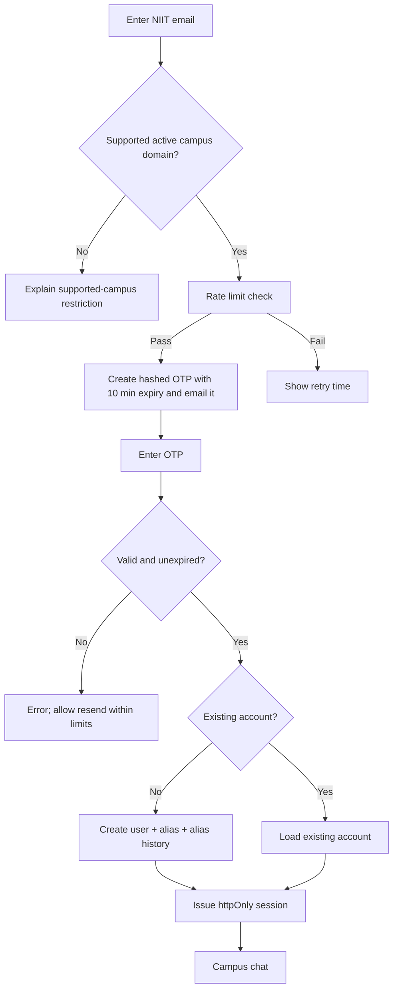
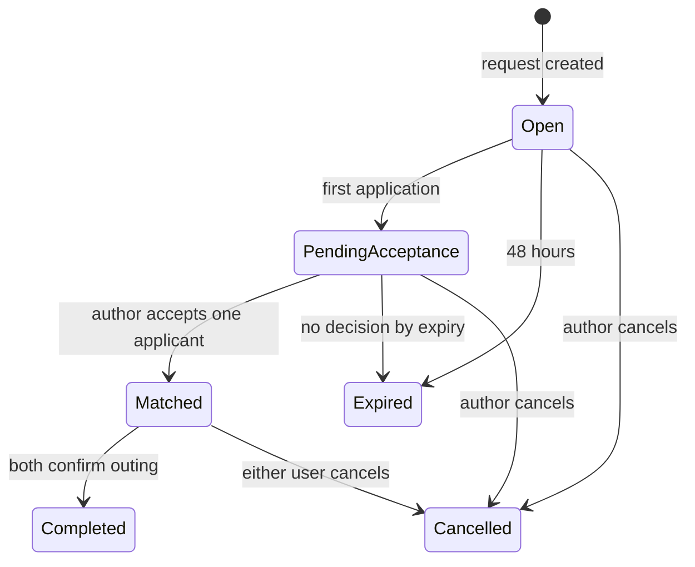

# User flows and edge cases

## 1. Verification and onboarding

Edge cases: banned/suspended users receive no usable session; a changed/invalid domain never receives an OTP; alias collision retries server-side; OTP use is single-use.

## 2. Campus chat

1. Authenticated user loads their campus room's last 50 messages.
2. Client opens an authenticated socket and joins only `campus:{campus_id}`.
3. Send pipeline: authorize active/mute status → 500-character limit → content policy filter → store → broadcast → report affordance.
4. At 20 messages/minute the server rejects the message and returns a retry warning.
5. A report records the immutable sender internal ID, not a client-provided alias.

## 3. Match lifecycle

Compatibility is evaluated server-side, scoped to campus, excludes the requester, and does not expose why an applicant was excluded. On acceptance, all unselected applications become `waiting`; a private room and two reveal-consent records are created transactionally.

## 4. Identity reveal

1. User A requests reveal in an active match.
2. User B gets a private notification and may accept or decline.
3. Only if both consent records are accepted does the match endpoint return each user's opted-in `reveal_name`.
4. A decline leaves both anonymous permanently for that match unless product policy later allows a fresh consent request.

## 5. Safety and moderation

1. Student reports a message/user with a reason.
2. Server verifies membership/visibility of the target and records it.
3. Three distinct reporters in 24 hours triggers a temporary mute for review.
4. Admin reviews evidence, then dismisses, warns, mutes, suspends, or bans with an audit action.
5. Auth and socket middleware check account status on every access.
