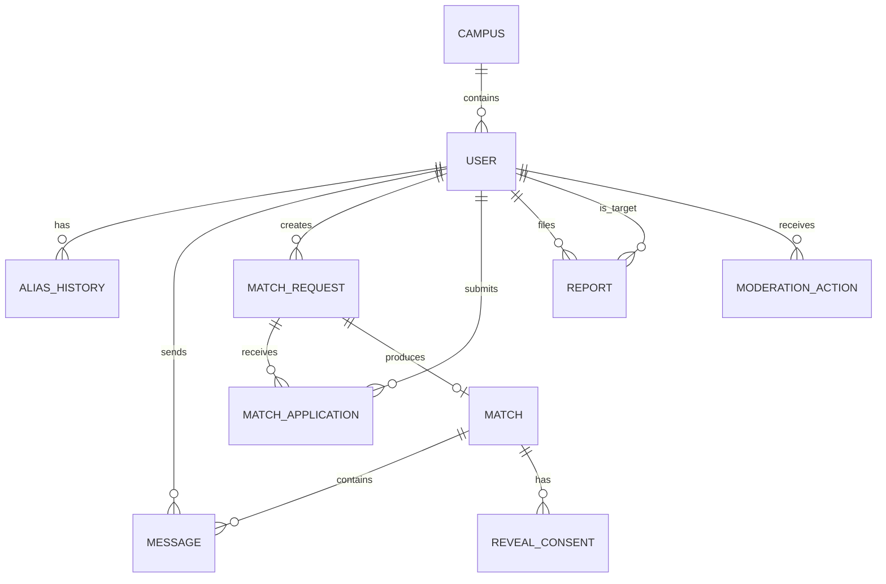

# Data schema and ownership

## Tenant boundary

`Campus` is the top-level tenant. Every public interaction has a `campus_id`, directly or through its owner. Every query must scope to the authenticated user's campus before filtering anything else.

## Tables

### `campuses`

| Field | Type | Rules |
|---|---|---|
| id | UUID | Primary key |
| slug | text | Unique, stable (`niit-university`) |
| name | text | `NIIT University` |
| email_domain | text | Unique, lower-case (`niituniversity.in`) |
| status | enum | `active`, `paused`, `retired` |
| created_at | timestamptz | Default now |

### `users`

| Field | Type | Rules |
|---|---|---|
| id | UUID | Internal primary key; never public |
| campus_id | UUID | FK campuses; indexed |
| email | text | Unique; encrypted-at-rest/provider protected in production |
| public_alias | text | Unique per campus; public |
| reveal_name | text nullable | Optional; only returned after mutual reveal |
| gender | enum nullable | `woman`, `man`, `nonbinary`, `self_described`, `prefer_not_to_say` |
| orientation | enum nullable | Used only for matching filters; never public |
| reputation_score | int | Default 100 |
| no_show_count | int | Default 0 |
| account_status | enum | `active`, `muted`, `suspended`, `banned` |
| created_at / last_active_at | timestamptz | Audit |

Unique constraint: `(campus_id, public_alias)`.

### `alias_history`

`id`, `user_id`, `alias`, `started_at`, `ended_at nullable`, `rotation_reason`. At most one open history record per user. Rotation runs atomically: close current history, insert new history, update `users.public_alias`.

### `chat_rooms`

`id`, `campus_id`, `kind` (`campus`, `match`), `match_id nullable`, `created_at`.

One campus room exists per active campus. A match room has exactly one linked match and no other members.

### `messages`

`id`, `room_id`, `sender_id`, `sender_alias`, `content`, `is_filtered`, `is_deleted`, `created_at`, `deleted_at nullable`.

Store `sender_alias` at send-time. A report may reference a deleted message, so deletion is soft.

### `match_requests`

`id`, `campus_id`, `requester_id`, `activity`, `location`, `scheduled_at`, `gender_preference`, `orientation_preference`, `status`, `expires_at`, `created_at`, `cancelled_at nullable`.

Status state machine: `open → pending_acceptance → matched → completed`; or `open/pending_acceptance → expired/cancelled`.

### `match_applications`

`id`, `request_id`, `applicant_id`, `status` (`pending`, `accepted`, `waiting`, `withdrawn`, `expired`), `created_at`.

Unique constraint: `(request_id, applicant_id)`. Applicant alias is never returned to request owner before acceptance.

### `matches`

`id`, `request_id unique`, `user_one_id`, `user_two_id`, `room_id unique`, `status` (`active`, `completed`, `cancelled`), `scheduled_at`, `created_at`, `completed_at nullable`.

Constraint: users must differ; both must belong to the request campus.

### `reveal_consents`

`id`, `match_id`, `user_id`, `status` (`pending`, `accepted`, `declined`), `requested_at`, `responded_at nullable`.

Unique constraint `(match_id, user_id)`. Only return `reveal_name` once both records have `accepted`.

### `reports`

`id`, `campus_id`, `reporter_id`, `reported_user_id`, `message_id nullable`, `reason`, `detail nullable`, `status` (`pending`, `reviewing`, `resolved`, `dismissed`), `created_at`, `resolved_at nullable`.

### `moderation_actions`

`id`, `campus_id`, `user_id`, `admin_user_id`, `type` (`mute`, `suspension`, `ban`, `warning`), `reason`, `starts_at`, `ends_at nullable`, `created_at`.

## Deletion and retention

- Account deletion anonymizes user-facing data after a retention period; moderation records retain the internal account reference per the published policy.
- Soft-delete messages; show a removal placeholder to users.
- OTP records expire in 10 minutes; sessions expire in 30 days and are revocable.
- Never store raw JWTs, plaintext OTPs, or passwords.
